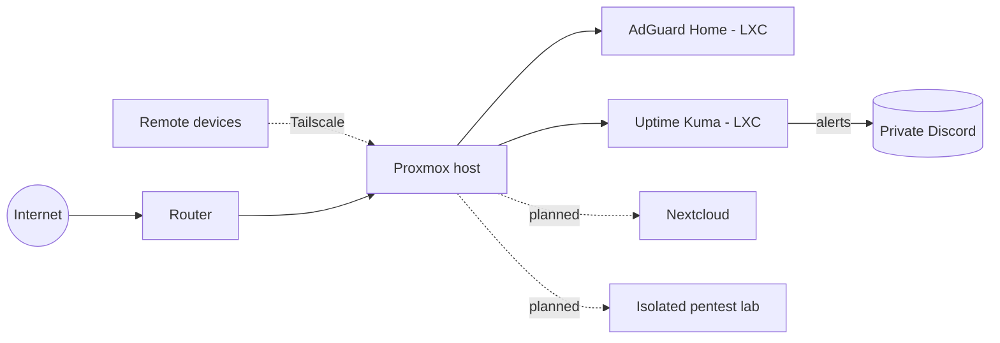

# 🏰 HomeLab

A self-hosted home lab built to learn hands-on networking, virtualisation and defensive security.

## Overview

## Hardware
- Small-form-factor desktop running 24/7 as the hypervisor
- External USB drive dock (planned) for storage

## Services

| Service | Type | Purpose | Status |
|---|---|---|---|
| Proxmox VE | Host | Hypervisor for VMs and containers | ✅ Running |
| Tailscale | Host | Secure remote access, no open ports | ✅ Running |
| AdGuard Home | LXC | Network-wide DNS ad/tracker blocking | ✅ Running |
| Uptime Kuma | LXC | Service monitoring + Discord alerts | ✅ Running |
| Nextcloud | LXC/VM | Private cloud storage for family | 🛠 Planned |

## Security principles
- **No ports exposed to the internet**: remote access only via a private mesh VPN
- **MFA everywhere**: TOTP on all admin accounts, with hardware keys planned
- **Least privilege**: day-to-day admin through a non-root account
- **Default-deny firewall**: management interfaces limited to trusted networks
- **Monitoring and alerting**: downtime is reported immediately
- **Secrets stay out of this repo**: no IPs, hostnames or credentials published

## Roadmap
- [x] Proxmox install and hardening
- [x] Tailscale remote access with subnet routing
- [x] AdGuard Home DNS filtering
- [x] Uptime Kuma monitoring with Discord alerts
- [ ] Point router DNS at AdGuard for whole-network filtering
- [ ] Nextcloud on an external drive (per-user accounts and quotas)
- [ ] RAM upgrade to 32GB and replacement of the failed SSD
- [ ] SMART disk health checks and backups
- [ ] Isolated pentest lab (Kali plus intentionally vulnerable VMs)
- [ ] Network traffic monitoring (ntopng / Zeek)
- [ ] Managed switch and VLAN segmentation
- [ ] YubiKey hardware MFA

## Lessons learned
- Subnet routes in Tailscale must be approved in the admin console before they work
- Containers can inherit the host's DNS, so set it explicitly per container
- Monitor what you can actually reach: locked-down devices will show as "down"
"# Home-Lab" 
>>>>>>> 6ae1daa (README.md update)
